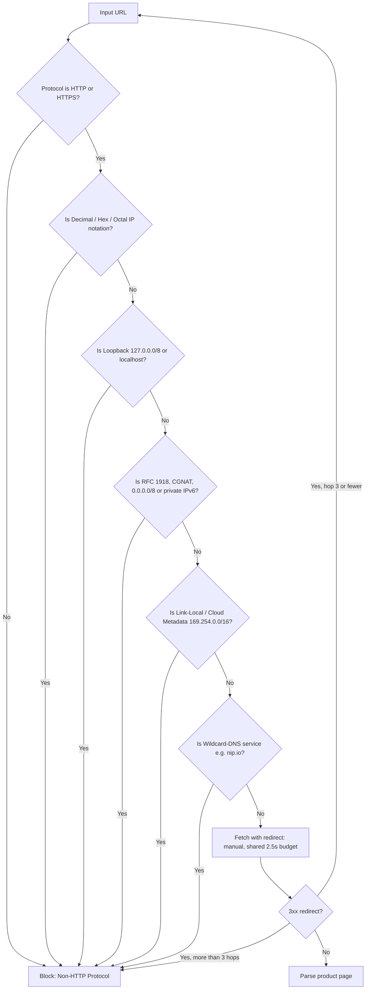

# KovertKlaus — Core Engineering & Security Invariants 🔒

**Document Version:** 1.0.0  
**Classification:** Core System Invariants & Enforcement Standards  

---

## 🏛️ 1. Cryptographic State & Sessions

> [!IMPORTANT]
> **Zero Unsigned Token Policy**:
> KovertKlaus will never issue or accept raw, unsigned identifiers (e.g. plain UUIDs) in cookies, query parameters, or request payloads.

1. **HMAC-SHA256 Signatures over Kind and Expiry**:
   Session cookies (`kovertklaus_session`, `kovertklaus_admin_session`) carry `<kind>.<subjectId>.<expiresAt>`, signed with HMAC-SHA256 under `SESSION_SECRET` (`issueSessionToken` / `readSessionToken` in `src/lib/session-token.ts`):
   $$\text{Token} = \text{kind} \parallel \text{"."} \parallel \text{subjectId} \parallel \text{"."} \parallel \text{expiresAt} \parallel \text{"."} \parallel \text{HMAC-SHA256}(\text{payload}, \text{secret})$$
   User tokens live 24 hours and slide while the agent is active; admin tokens live 8 hours and never renew. A token of the wrong kind, an expired token, or a pre-format token without kind and expiry is rejected. A password change revokes all earlier user tokens (`User.sessionsRevokedAt`).
2. **Constant-Time Verification**:
   Signature validation uses `crypto.timingSafeEqual(expectedBuf, actualBuf)` to completely eliminate side-channel timing attack vectors.
3. **Invalidation on Tampering**:
   Any token with an invalid signature, corrupted payload, or empty string is rejected with an immediate `401 Unauthorized` without querying the database.

---

## 🛡️ 2. Parameter Tampering & Identity Isolation

1. **Single Source of Identity Truth**:
   The authenticated user's identity is derived exclusively from the cryptographically verified session context.
2. **Rejection of Client-Supplied Identity**:
   Mutating endpoints explicitly reject or ignore client-supplied identity overrides such as `body.userId` or `?userId=...`.
3. **Multi-Tenant / Mission Authorization**:
   Even if an operative has a valid session, mission actions (`draw`, `swap`, `addExclusion`, `closeRecruitment`) verify that `session.userId === exchange.organizerId`.

---

## 🌐 3. Strict Trust Boundaries & Anti-SSRF Defense

The product metadata scraper (`src/app/api/scraper/route.ts` and its Worker twin) accepts external URLs submitted by operatives. To prevent Server-Side Request Forgery (SSRF), every URL, and every redirect target, passes `isSafePublicUrl` (`src/lib/security.ts`) before `fetchProductPage` (`src/lib/product-fetch.ts`) requests it:

> [!NOTE]
> **Known limitation:** the checks run on the URL's hostname; the hostname is not resolved first, so a public domain whose DNS record points at a private address is not caught here. The Cloudflare Workers runtime cannot reach private networks; self-hosted Node deployments rely on network placement for this case.

---

## 🗄️ 4. Concurrency, Atomic Transactions & Resource Lifecycle

1. **Atomic Mutation Boundaries**:
   All multi-entity updates (such as target assignment derangements, broadcast notifications, and cascade swaps) are executed inside atomic interactive transactions (`db.$transaction(async (tx) => …)`; the array form fails through the `db` proxy, see `src/lib/db-transactions.test.ts`). This guarantees data consistency and eliminates sequential $O(N)$ database round-trips.
2. **Explicit Connection Pool Teardown**:
   Database disconnects and cache invalidation routines explicitly await connection closure (`client.$disconnect()`, `pool.end()`) inside `try...catch` blocks to prevent dangling sockets.
3. **Relational Index Directives**:
   All foreign keys, status fields, and compound query paths (`ExchangeMember.exchangeId`, `ExchangeMember.userId`, `Wishlist.userId`, `Exchange.code`, `Item.url`) are backed by explicit Prisma schema index directives (`@@index`, `@unique`).
4. **Rejection-Sampled CSPRNG**:
   All security-relevant randomness (the gift-circle draw, invite codes, tokens) uses Web Crypto / Node CSPRNG (`crypto.getRandomValues` / `crypto.randomFillSync`); random integers use rejection sampling (`getSecureRandomInt`) to eliminate modulo bias. `Math.random()` must never be used for anything security-relevant.
